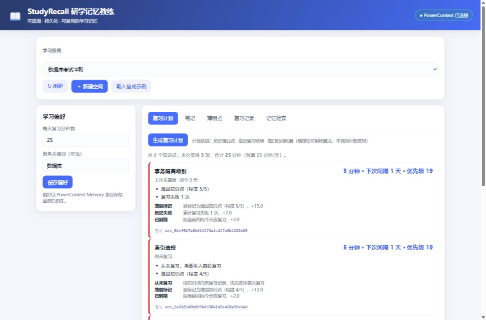
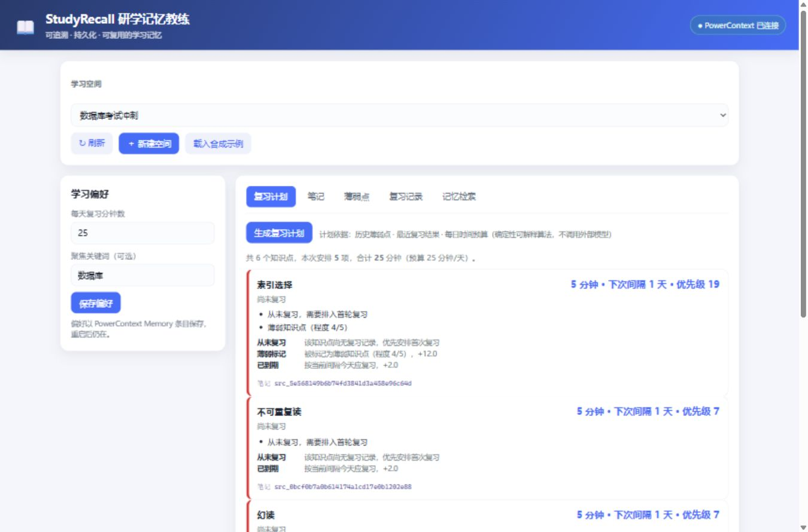
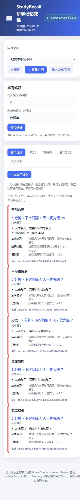

# StudyRecall 研学记忆教练

中文优先的学习资料与复习进度管理工具。学习者建立学习空间、导入笔记、记录复习自评；
应用依据既往记忆生成**确定性、可解释**的复习计划。所有核心持久状态都真实存放在
**OceanBase PowerContext** 中，重启进程后仍可读取。

> 本作品的主要编码、调试与验证均由 **Qoder CN** 本次真实会话完成。协调方 **Codex** 负责
> 需求梳理、真实浏览器行为核验与应用截图采集（详见 `COORDINATOR_QA.md`）。开发记录见
> [`docs/DEVLOG.md`](docs/DEVLOG.md)，可复现验证记录见 [`docs/VERIFICATION.md`](docs/VERIFICATION.md)。
>
> 代码仓库（交付分支，由协调方基于官方生态模板创建，不覆盖其他方案分支）：
> <https://github.com/LiuHy318/powercontext/tree/feature/qoder-study-coach/qoder/study-coach>

---

## 1. 它解决什么

- 复习安排有依据、可追溯：每个计划项都说明“为什么今天复习它”，并给出下次间隔。
- 学习记忆持久化：空间、笔记、偏好、薄弱点、复习记录重启后不丢失。
- 真实而非“假装智能”：检索仅使用 PowerContext 全文检索（FTS），不调用任何外部收费模型，
  绝不把未配置的向量检索描述成语义检索。

## 2. 架构与 PowerContext 的真实映射

```
浏览器 (原生 HTML/CSS/JS)
      │  fetch JSON
      ▼
StudyRecall FastAPI 应用 (app/)          —— 仅负责编排、输入校验、确定性算法
      │  powercontext.client.PowerContextClient (HTTP SDK)
      ▼
真实 PowerContext Server (SQLite 持久化)  —— 唯一的事实存储
```

| 业务对象 | PowerContext 概念 | 使用的真实 SDK 方法 |
|---|---|---|
| 学习空间（隔离） | Scope | `create_scope` / `list_scopes`（跟随 `next_cursor` 翻完所有页）/ `get_scope`，外部引用标签 `study-recall-space` |
| 学习笔记本 | content `Source` | `create_source` / `get_source` / `list_sources`（跟随 `next_cursor` 翻完所有页，返回 `source_id` 与 `sha256` 摘要） |
| 学习偏好 | Memory 条目 `kind=preference` | `remember_memory` / `revise_memory_entry` / `list_memory_entries` |
| 薄弱知识点 | Memory 条目 `kind=weak-point` | 同上（按知识点去重更新） |
| 复习记录 | Memory 条目 `kind=review` | `remember_memory` / `list_memory_entries` |
| 记忆检索 + 来源引用 | Memory FTS + Source | `search_memory(mode=fts)` + `list_sources` |

应用**不**另建 SQLite 记忆表、**不**用 JSON 文件冒充 PowerContext、**不**使用浏览器本地假存储。
浏览器 `localStorage` 仅记住“上次选中的空间 id”（导航便利），不是业务数据。

复习计划算法位于 [`app/scheduler.py`](app/scheduler.py)：纯函数、无 I/O、无外部模型，
输入相同 + 时间相同则输出确定相同；每项包含理由（`reasons`）与因子分解（`factors`）。

## 3. 目录结构

```
qoder/study-coach/
  app/                后端：config / domain / powercontext_store / scheduler / sample_data / main
  static/             前端：index.html / styles.css / app.js（响应式中文 UI）
  scripts/            pc_server.py（隔离启动真实 PowerContext）· run_all.py · run_app.py · smoke_test.py
  tests/              真实集成测试 + 调度算法单测 + 验收样例
  site/               Qoder Sites 静态展示页（合成演示，未连接后端）
  docs/               DEVLOG.md · VERIFICATION.md · SUBMISSION.md
  requirements.txt · config.example.env · .gitignore
```

运行时产物（PowerContext 数据库、日志、缓存、虚拟环境）均写入被 `.gitignore` 忽略的 `.runtime/`，
不纳入交付资产。

## 4. 安装

需要 **Python 3.12**。建议使用独立虚拟环境（放在被忽略目录亦可）。运行时无需任何本地绝对路径。

> **关于基线的重要更正**：官方仓库 `oceanbase/powercontext` 的 `2026-competition-ecosystem`
> 分支是一个**空资产模板**（仅 `dify/gaode/minimax/qoder/stepfun` 目录与 `.gitkeep`），
> **并非可安装的 SDK**，不能 `pip install` 出 PowerContext。真正可复现的运行时来自 **PyPI 上的
> 官方发布版**。本作品在“干净虚拟环境”（不带 `--system-site-packages`、不含任何 editable 兄弟包）
> 中以 `pip install "powercontext[client,cli,server]==1.2.0"` 完整跑通 19 项测试（见 `docs/VERIFICATION.md`）。
>
> 说明：开发机上曾以 editable 兄弟源码 `powercontext @ d0813396beea304b4ded9911f516dbea1a28b58e`
> （版本 `1.2.1.dev3+gd0813396b`，即在官方赛事基线 `9db1753434162c0aa7c9f1189a1722e617880a52`
> 之上仅追加 PDF 功能）实测；本应用只用到 `client/cli/server` 三个 extra 提供的稳定公共 HTTP API，
> 故以 PyPI 官方 `1.2.0` 为准。若需逐字节复现赛事提交，可改用官方 git 提交安装（切勿使用模板分支）。

```bash
# 1) 建干净虚拟环境（PowerContext 为运行时后端，单独固定官方版本）
python -m venv .venv
#   Windows:  .venv\Scripts\activate     POSIX:  source .venv/bin/activate

# 2) 安装真实 PowerContext（官方 PyPI 发布版：client SDK + cli 启动器 + server 运行时/内置 SQLite）
pip install "powercontext[client,cli,server]==1.2.0"

# 3) 安装 StudyRecall 应用依赖（requirements.txt 也已固定同一 PowerContext 版本）
cd qoder/study-coach
pip install -r requirements.txt
```

> `powercontext[cli]` 提供 `powercontext server run` 命令所需的 `typer`；`[server]` 提供
> FastAPI、Uvicorn 与内置 SQLite 持久化。无需配置任何 generation / embedding 模型，应用不使用外部模型。
> Windows 提示：把虚拟env 建在较浅的路径可避免依赖深层文件名触及 260 字符路径上限（或开启系统长路径支持）。

## 5. 运行

一条命令同时启动“真实 PowerContext Server（隔离存储于 `.runtime/demo`）+ 应用”：

```bash
python scripts/run_all.py            # 默认应用 http://127.0.0.1:8010
```

浏览器打开 <http://127.0.0.1:8010>：

1. 点「载入合成示例」→ 自动创建“数据库考试冲刺”空间、2 段笔记、每天 25 分钟、两个薄弱点；
2. 「复习计划」→ 生成计划，观察薄弱点被优先安排、每项附理由与下次间隔；
3. 「复习记录」→ 记一次「未掌握」，重新生成计划，观察优先级/排序变化；再记「已掌握」，观察间隔增大；
4. 「记忆检索」→ 输入关键词，查看真实来源引用（`scope_id` / `source_id` / `sha256` 摘要）；
5. 关闭再重启 `run_all.py` → 选择同一空间，数据仍在（重启恢复）。

分步启动（可选）：
```bash
# 终端 A：仅启动 PowerContext Server（隔离 HOME）
POWERCONTEXT_HOME=$(pwd)/.runtime/demo powercontext server run --host 127.0.0.1 --port 8777 --no-env-file
# 终端 B：启动应用，指向已有 Server
STUDYRECALL_SERVER_URL=http://127.0.0.1:8777 python scripts/run_app.py --port 8010
```

## 6. 测试

```bash
python -m pytest -q
```

集成测试会**自行启动一个隔离的真实 PowerContext Server**（`.runtime/testdata`），因此运行时需要
`powercontext[client,cli,server]` 已正确安装。共 **19 项**：真实写入/读取、计划使用既往记忆、空间隔离、
**进程重启恢复**、空空间初始体验、无效输入、后端不可用，以及**分页回归**——单空间写入 101 条笔记
（超过 SDK 单页 100 条上限）后必须全部列出并进入计划、创建 55 个空间（超过默认页 50）后必须全部列出。
启动器与就绪探测均已对**本地回环**绕过系统代理（`NO_PROXY` 追加 `127.0.0.1/localhost/::1`，不影响其它远程
代理），就绪失败只清理**自己启动的那一个**子进程，不留孤儿服务。实测输出与逐条结果见
[`docs/VERIFICATION.md`](docs/VERIFICATION.md)。

## 7. 演示与真实的边界 / 错误处理

- 后端不可用：应用返回 HTTP 502/503 与明确错误文案，前端顶部红色横幅显示，绝不以本地假数据冒充成功。
- 输入不合法：FastAPI 校验返回 422，前端解析并展示具体字段错误。
- 检索仅报告 `mode=fts`，不谎称语义/向量。
- 合成示例（`app/sample_data.py`）在 UI 与站点中均明确标注为虚构演示资料。

## 8. 界面实拍（真实应用截图）

以下三张均为**本地运行真实应用后由协调方 Codex 用浏览器截取的实际界面**（非设计稿、非 Qoder 原生对话截图）。
桌面视口 1365×900，移动视口 390×844（文档宽度 375 ≤ 视口 390）。

| 生成复习计划 | 记为「已掌握」后计划变化 | 移动端布局 |
|---|---|---|
|  |  |  |

## 9. 隐私与安全

- 不提交任何凭据、个人数据或环境转储；`config.example.env` 仅含占位值。
- 默认在本地回环、Access Mode=disabled 运行，无需 Token；若需对外暴露必须启用鉴权。
- 全程未调用外部收费模型，未读取或打印任何密钥。

## 10. 已知限制

- 记忆检索为关键词（FTS）匹配；未来可在配置 embedding 后启用向量/混合检索，届时再据实声明。
- 单条 Memory 文本上限 8192 字节；超长笔记正文可分段导入。
- 展示站 `site/index.html` 为静态合成演示，未连接数据库；真实体验需本地运行。
